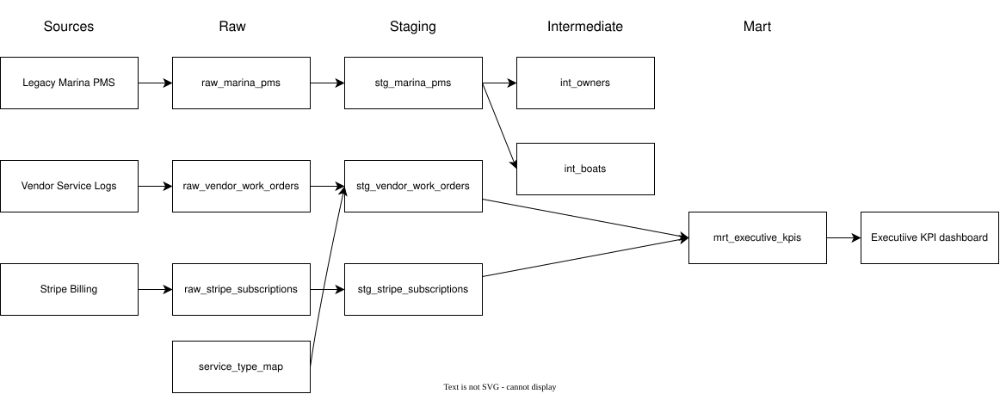

# Marina Platform: dbt Case Study

A dbt project on Snowflake that cleans three raw marina sources, resolves duplicate owners and boats, and serves executive KPIs from one mart.



## Models
 
- `stg_marina_pms`: casts `$1,200.00` strings to `DECIMAL(10,2)`, splits contact into email or phone, normalizes hull IDs.
- `stg_vendor_orders`: maps raw service strings to 4 categories via the `service_type_map` seed; unmapped values become `Unmapped`.
- `stg_stripe_subscriptions`: types and standardizes subscription events.
- `int_owners`: resolves duplicate customers into one `owner_id`.
- `int_boats`: one `boat_id` per normalized hull ID, linked to its owner.
- `mrt_executive_kpis`: MRR, ARR, vendor utilization, vendor response time.

## Run it

Set up a Snowflake connection (profile `default`), then:

```
dbt build
```

This loads the seeds, builds all models, and runs the tests.
